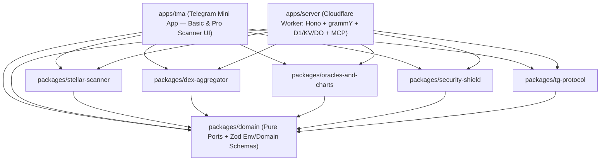
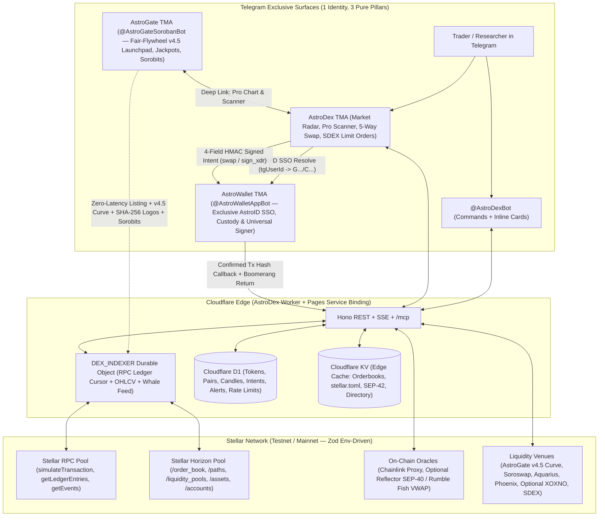
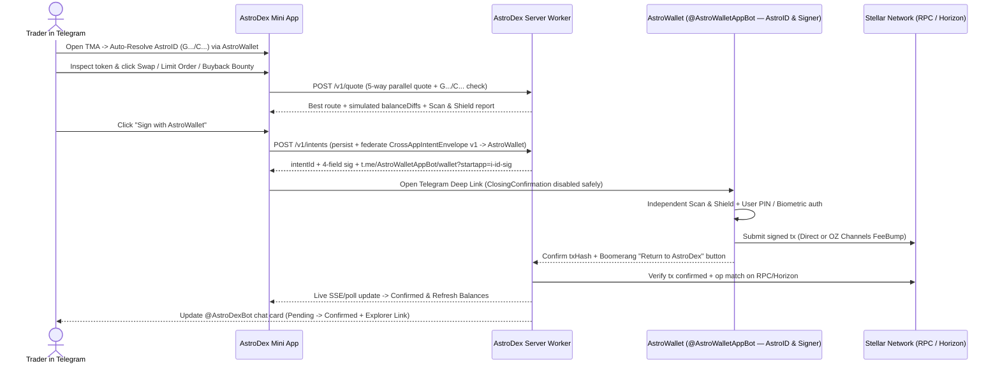

# AstroDex — Modular System Architecture

## 1. Architectural Principles

1. **Zero Key Custody & Exclusive `AstroID` SSO (`AstroWallet` Control Hub):** `AstroDex` never asks for, stores, or processes private keys (`S...`), BIP-39 mnemonics, or vault PINs, and never duplicates wallet onboarding or SEP-53 linking flows. Users authenticate seamlessly via `Telegram.WebApp.initData` (`HMAC-SHA256`), resolve their linked **AstroWallet `AstroID`** public addresses (`G...` Classic + optional `C...` Smart Account) and Sorobits SEP-50 avatar, simulate transactions via `@astrodex/security-shield`, and authorize execution through **AstroWallet** (`https://t.me/AstroWalletAppBot/wallet?startapp=i-<intentId>-<sig>`) using the bit-exact 4-field HMAC token (`${network}:${intentId}:${telegramUserId}:${expiresAt}`) and `CrossAppIntentEnvelope v1`.
2. **Hexagonal Monorepo Boundaries:** Pure domain models, forensic asset scanning, 5-way liquidity aggregation, on-chain oracle pricing, pre-sign simulation, and Telegram protocol helpers live in strict DAG-isolated packages. Neither React UI state, Cloudflare bindings, nor `grammY` bot handlers may leak into `@astrodex/domain` or ledger adapters.
3. **100% Telegram-Exclusive Mini App & ToS Clause 7.3–7.4 Compliance:** `apps/tma` executes strictly inside Telegram (`TelegramOnlyGate`, zero standalone marketing site, zero `window.stellar`, zero non-TON WalletConnect/Reown external dApp bridges), strictly in English, with `frame-ancestors https://web.telegram.org https://*.telegram.org` CSP enforcement.
4. **Honest Classic (`G...`) vs. Smart Account (`C...`) Protocol Routing:** `AstroDex` exposes Stellar protocol rules transparently:
   - Classic `G...` accounts support native SDEX Limit Orders (`manageBuyOffer`/`manageSellOffer`), `pathPaymentStrictSend`, `changeTrust`, CAP-38 Liquidity Pools, and Soroban SAC swaps. `AstroDex` defaults to `G...` when `VITE_SMART_ACCOUNT_WASM_HASH` is unset or the user has no deployed `C...` Smart Account.
   - Smart Accounts `C...` route exclusively through Soroban AMMs / AstroGate Curve (or invoke a 1-tap SAC transfer intent to the user's linked `G...` when Classic SDEX orderbooks are needed).
5. **Zero-Hardcoding Production Parity:** Every network passphrase, Stellar RPC/Horizon failover pool, Soroswap/XOXNO/AstroGate/Oracle contract address, SEP-42 registry, and Telegram bot handle flows through Zod-validated config in `@astrodex/domain` (`STELLAR_NETWORK=testnet|mainnet`).

---

## 2. Consolidated Modular Monorepo Structure

```text
AstroDex/
├── packages/
│   ├── domain/                  # Pure TS types, Ports (ScannerPort, RouterPort, OraclePort,
│   │                            #   LimitOrderPort, IntentPort, AgenticPaymentPort), Zod Env/Market/Audit schemas
│   ├── stellar-scanner/         # "SDEX Reboot + Soroban X-Ray" Forensic Engine:
│   │   ├── classic/             #   Issuer Lock math (master_weight + signers < threshold),
│   │   │                        #   AUTH_REQUIRED/REVOCABLE/CLAWBACK/IMMUTABLE, SEP-1 stellar.toml
│   │   ├── soroban/             #   SEP-41/48/55 checks, Stellar Registry, owner()/admin(),
│   │   │                        #   7Y LP Lock vs GAAAA...WHF burn, 48h timelock, 30d CurveClosed,
│   │   │                        #   Protocol 23 TTL/Archival status, AstroGate SHA-256 logo & Sorobits XP
│   │   ├── holders/             #   SEP-41 + Horizon Top-10 holder & whale concentration analyzer
│   │   └── scorer/              #   Deterministic Astro Shield Score (0-100) + Basic/Pro verdicts
│   ├── dex-aggregator/          # 5-Way Smart Liquidity Router & Classic Limit Orders:
│   │   ├── soroswap/            #   Worker-proxied Soroswap Aggregator + Direct Pair/Router (bigint)
│   │   ├── xoxno/               #   Optional XOXNO Swap Aggregator Router adapter (graceful fallback)
│   │   ├── astrogate-curve/     #   Fair-Flywheel v4.5 Bonding Curve exact bigint quote/build (0->1,000 XLM)
│   │   ├── sdex/                #   Horizon /order_book walk, /paths/strict-send, CAP-38 LPs,
│   │   │                        #   native manageBuyOffer / manageSellOffer + auto changeTrust
│   │   └── smart-router/        #   Parallel Promise.allSettled quote engine + G.../C... compatibility filter
│   ├── oracles-and-charts/      # On-Chain Oracles & Market Data Engine:
│   │   ├── oracles/             #   Chainlink Stellar Proxy, optional Reflector SEP-40 / Rumble Fish VWAP, CEX fallback
│   │   └── charts/              #   Horizon /trade_aggregations -> /trades -> /order_book + D1 OHLCV merger
│   ├── security-shield/         # Pre-Sign Transaction Audit (aligned with @astrowallet/security-shield):
│   │   ├── decoder/             #   Zero-WASM @stellar/stellar-sdk + contract.Spec (SEP-46/47/48)
│   │   ├── simulator/           #   Stellar RPC simulateTransaction (xdrFormat: "json", balanceDiffs, TTL)
│   │   ├── rules/               #   SEP-42 anti-spoof, StellarExpert Directory, drainer AST heuristics
│   │   └── raw-xdr-worker/      #   Lazy Web Worker for @stellar/stellar-xdr-json (~3 MB WASM on-demand only)
│   └── tg-protocol/             # Telegram Auth & Cross-App Signed Intents:
│                                #   initData HMAC verification, 15m session tokens,
│                                #   Bit-exact 4-field HMAC tokens + CrossAppIntentEnvelope v1
│                                #   (AstroDex <-> AstroWallet AstroID <-> AstroGate v4.5)
├── apps/
│   ├── tma/                     # Telegram-Exclusive Apple Liquid Glass Mini App (React 19 + Vite):
│   │                            #   Unified AstroID Header (Sorobit SVG + @user + Wallet/Launchpad/DEX switch),
│   │                            #   Basic <-> Pro Scanner Toggle, TradingView Lightweight Charts,
│   │                            #   Combined Depth Chart, Live SDEX Orderbook + Limit Orders,
│   │                            #   AstroGate v4.5 Command Center, AstroWallet Intent Handoff
│   └── server/                  # Cloudflare Worker (Hono + grammY + D1 + KV + DEX_INDEXER DO + MCP):
│                                #   /tg/webhook          -> @AstroDexBot Commands + Inline Scanner Cards
│                                #   /v1/tg/auth          -> initData HMAC auth -> 15m Bearer token
│                                #   /v1/wallet/resolve   -> AstroID SSO cascade (AstroWallet -> AstroGate)
│                                #   /v1/markets/*        -> Trending, AstroGate Radar, Live Whale Tape
│                                #   /v1/scanner/:assetId -> Cached Forensic Audit + Protocol 23 TTL status
│                                #   /v1/quote & /build   -> 5-Way Smart Router + Pre-Sign Simulation + Intent
│                                #   /v1/intents          -> Create & federate CrossAppIntentEnvelope v1
│                                #   /v1/orderbook/:pair  -> Live SDEX Orderbook + Combined Depth + OHLCV
│                                #   /v1/proxy/*          -> SSRF-hardened stellar.toml, StellarExpert, Soroswap
│                                #   /mcp, /openapi.json  -> AI Agent MCP & OpenAPI discovery
└── docs/                        # INDEX.md, DESIGN_SYSTEM.md, ENV_MATRIX.md, ECOSYSTEM_INTEGRATION.md
```

### Package Dependency DAG



---

## 3. Ecosystem Topology (`AstroWallet` $\leftrightarrow$ `AstroDex` $\leftrightarrow$ `AstroGate v4.5`)



---

## 4. Core Subsystems

### A. 5-Way Smart Liquidity Aggregator & Native SDEX Limit Orders (`dex-aggregator`)

For every swap request, `SmartRouter` validates the asset pair through the 3-tier anti-scam shield (blocking any spoofed protected ticker) and runs a parallel `Promise.allSettled` race across up to **5 liquidity venues**, filtering automatically by the user's active account type (`G...` vs `C...`) while degrading gracefully when optional Mainnet-only adapters are unconfigured on Testnet:

| Venue | Mechanism | Account Support | Notes |
| :--- | :--- | :--- | :--- |
| **1. AstroGate Bonding Curve v4.5** | Virtual constant-product (`1,000 vXLM` $\rightarrow$ `1,000 real XLM`) | `G...` & `C...` | Active while `!graduated` (and `< 30d` expiry); automatically switches to Soroswap Pair upon graduation. |
| **2. Soroswap Aggregator API (Proxied)** | Split-routing across Soroswap, Aquarius, Phoenix, Sushi V3, Comet, SDEX | `G...` & `C...` | Server-side proxy protects `sk_` key and caches quotes under `1 req/s` free tier limits. |
| **3. XOXNO Swap Aggregator Router *(Optional)*** | Independent on-chain Soroban router + public REST API | `G...` & `C...` | Gracefully skipped when `XOXNO_SWAP_API_BASE` is unset (e.g., Testnet); provides zero-downtime redundancy on Mainnet. |
| **4. Direct Soroswap Pair/Router (On-Chain)** | Reads `Pair.token_0()`, `token_1()`, `get_reserves()` + `router_get_amount_out` | `G...` & `C...` | Zero third-party API dependency; `transfer`-based router requires no unnecessary `approve`. |
| **5. Classic SDEX + CAP-38 Paths** | Horizon `/paths/strict-send` + `/order_book` bid-walk fallback | `G...` only | Zero API key; atomically prepends `changeTrust` when missing on `G...` (with `0.5 XLM` reserve check or 1-tap `LumenWipe` / relay hint). |

- **Native Classic SDEX Limit Orders (`G...`):** `apps/tma` (Pro Mode) and `dex-aggregator` build `Operation.manageBuyOffer` / `Operation.manageSellOffer` (create, update, cancel with `amount = "0"`), bundle missing `changeTrust` operations automatically, validate Horizon selling/buying liabilities and reserve margins, and hand off the simulated XDR as `actionType: "sign_xdr"` to **AstroWallet**.

### B. "SDEX Reboot + Soroban X-Ray" Forensic Scanner (`stellar-scanner`)

Produces a deterministic **Astro Shield Score (`0–100`)** and dual **Basic Summary + Pro Forensic Matrix**:
1. **Classic Asset (`G...`) Inspection:**
   - **Mathematical Issuer Lock:** Checks `thresholds.low_threshold`, `med_threshold`, `high_threshold`, `master_weight`, and every entry in `signers[]`. An issuer is marked *Supply Locked* **only** if `master_weight == 0` AND the total combined weight of all remaining signers cannot reach the lowest threshold required to emit or alter flags.
   - **Compliance Flags:** `AUTH_REQUIRED`, `AUTH_REVOCABLE` (Freeze risk), `AUTH_CLAWBACK_ENABLED` (Confiscation risk), `AUTH_IMMUTABLE`.
   - **SEP-0001 `stellar.toml` & Registry Check:** Proxied through SSRF-hardened `/v1/proxy/stellar-toml`, matched against **SEP-42** lists and **StellarExpert Directory** (`#malicious`, `#unsafe`, `#exchange`).
2. **Soroban Token (`C...` / SEP-41) Inspection:**
   - **Mint Authority & Upgradeability:** Queries `owner()` / `admin()`, inspects **SEP-48 `contract.Spec`** for privileged entrypoints (`mint`, `clawback`, `set_admin`, `burn_from`, `upgrade`), and flags 48h timelocked governance (`propose_upgrade`/`execute_upgrade`/`cancel_upgrade` in AstroGate v4.5) vs. instant upgrade keys.
   - **Verified Source & Registry:** Checks **SEP-0055** build attestation and **Stellar Registry (`rgstry.xyz`)** status, plus known audited WASM hashes (such as **AstroGate `astro-token`**).
   - **LP Security & Curve Lifecycle Verification:** Distinguishes **7-Year Contract-Locked LP** (`AstroGate Launchpad`), **Canonical Blackhole Burn** (`GAAAA...WHF`), **30-day `CurveClosed` Principal Refund**, and **Unlocked EOA LP** (rug-pull warning).
   - **Logo & Sorobits Metadata:** Resolves SHA-256 content-addressed logos from `${ASTROGATE_API_BASE_URL}/api/v1/logos/*` and Sorobits SEP-50 `TokenBaseXp` status.
   - **Protocol 23 ("Whisk" CAP-0062/0066) State Archival & TTL:** Reads contract instance and persistent storage `liveUntilLedgerSeq` via `getLedgerEntries`, warning users before critical pools/tokens expire and providing a 1-tap **"Extend TTL"** `sign_xdr` Intent to AstroWallet.
3. **Top-10 Holder & Whale Concentration:** Combines authoritative pool reserves, creator balance, vesting/escrow contracts, and recent SEP-41 events (`transfer`, `mint`, `burn`) to flag whale dominance outside the pool.

### C. End-to-End Boomerang Signed Intent Handoff (`AstroDex` $\leftrightarrow$ `AstroWallet`)



### D. Real-Time Indexer (`DEX_INDEXER` DO) & Cloudflare D1 Schema

Because Soroswap Pair contracts do not emit dedicated `swap` events and Stellar RPC retains only ~7 days (`~10k–120k` ledgers), `apps/server` maintains persistent history in **Cloudflare D1**:
- **Ingestion Sources:**
  1. `SoroswapFactory` `new_pair` events $\rightarrow$ auto-registers new Soroban pairs.
  2. `AstroGate Launchpad v4.5` events (`Launch`, `Buy`, `Sell`, `Graduated`, `JackpotClaimed`, `CurveClosed`, `BuybackBurn`, `BurnShout`) $\rightarrow$ instant Launchpad Command Center updates.
  3. Registered Pair **SEP-41 `transfer`** events (and **Protocol 23 CAP-0067** unified ledger events) $\rightarrow$ derives exact trade direction, volume, spot price, and builds `1m`, `5m`, `15m`, `1h`, `4h`, `1d` OHLCV candles + whale alerts.
  4. Horizon `/trades` & `/trade_aggregations` backfill for Classic SDEX pairs.
- **Core D1 Tables:**
  - `dex_tokens` (normalized `asset_key`, `kind`: `classic|soroban`, `sac_id`, `code`, `issuer`, `decimals`, `logo_url`, `shield_score`, `verified_launchpad`, `updated_at`)
  - `dex_pairs` (`pair_id`, `venue`, `base_asset_key`, `quote_asset_key`, `reserve_base`, `reserve_quote`, `lp_lock_kind`, `last_ledger`, `updated_at`)
  - `ohlcv_candles` (PK `(pair_id, timeframe, bucket_ts)`, `open`, `high`, `low`, `close`, `volume_base`, `volume_quote`, `tx_count`)
  - `whale_trades` (`tx_hash`, `pair_id`, `side`, `trader_addr`, `amount_base`, `amount_xlm`, `ledger`, `created_at`)
  - `user_watchlists` & `price_alerts` (`id`, `telegram_user_id`, `asset_key`, `condition`, `threshold`, `active`)
  - `signed_intents` (`intent_id` PK, `telegram_user_id`, `network`, `action_type`, `sub_action`, `xdr_sha256`, `hmac_sig`, `status`, `tx_hash`, `expires_at`)
  - `processed_tg_updates` & `rate_limits` (idempotency & atomic abuse prevention)

---

## 5. Security Headers & Runtime Parity

- **CSP (`_headers` / Cloudflare Pages):**
  `default-src 'self'; script-src 'self' https://telegram.org 'wasm-unsafe-eval'; style-src 'self'; img-src 'self' data: https:; connect-src 'self' <CONFIGURED_STELLAR_AND_ECOSYSTEM_ORIGINS>; worker-src 'self'; object-src 'none'; frame-ancestors https://web.telegram.org https://*.telegram.org; base-uri 'self'; form-action 'self';`
- **Lazy WASM Rule:** `@stellar/stellar-xdr-json` (~3 MB WASM) is strictly excluded from initial `apps/tma` bundles and loaded exclusively inside a dedicated Web Worker (`inspectRawXdrInWorker`) when a Pro user opens the Raw XDR Inspector.
